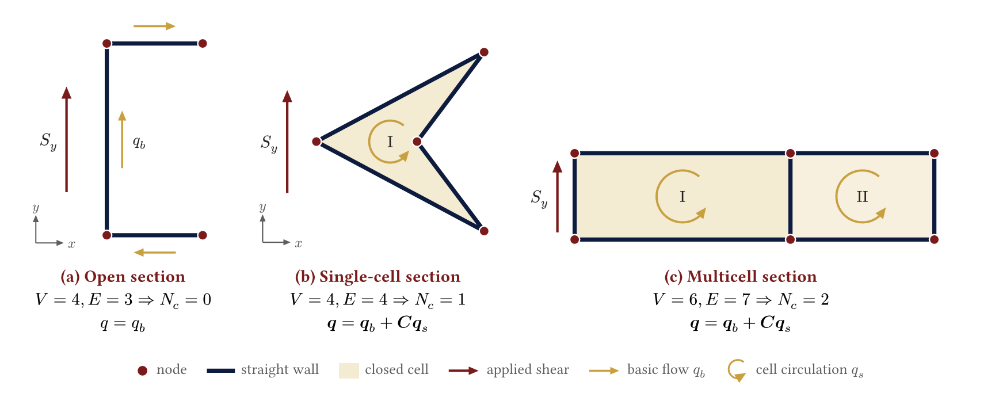
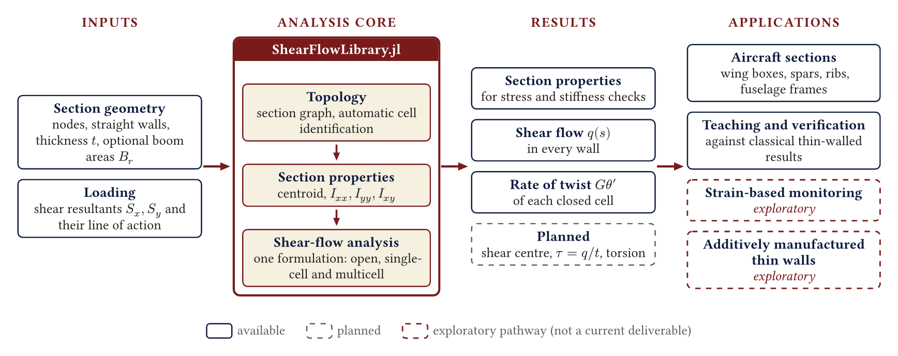

# ShearFlowLibrary.jl

### A Julia Toolbox for the Analysis of Thin-Walled Sections

**A graph-based computational framework for shear-flow analysis of arbitrary open, single-cell and multicell thin-walled sections.**

📄 **Full project overview (PDF):** [`docs/ShearFlowLibrary_README.pdf`](docs/ShearFlowLibrary_README.pdf)

ShearFlowLibrary.jl is an ongoing M.Tech research project that develops a modular Julia framework for the analysis of thin-walled aerospace structures. A cross-section is described as a graph of nodes and straight walls; from that description the library derives the section topology, the section properties and the shear-flow distribution, with **one formulation covering open, single-cell and multicell sections**. The objective is a flexible, extensible tool that bridges classical aircraft structural analysis with modern scientific computing.

  

Geometries of the three benchmark cases (loads shown schematically).

> **One formulation for every topology:** $\mathbf{q}=\mathbf{q}_b+\mathbf{C}\mathbf{q}_s$ with $N_c=E-V+1$. The closed cells and their redundant shear flows are identified from the section graph, so the analyst never has to choose where to cut a cell.

---

## Key features

| Graph-based geometry | Section properties |
|---|---|
| Node- and edge-based description of the section · half-edge topology for connectivity · automatic identification of closed cells · spanning-tree representation of independent cycles | Centroid · second moments of area $I_{xx}$, $I_{yy}$, $I_{xy}$ · closed-form evaluation for straight wall strips · optional discrete boom areas |
| **Generalised shear flow** | **Analytical, matrix-based solution** |
| Open, single-cell and multicell sections · arbitrary cell adjacency (no sequential cell ordering) · shear loads $S_x$, $S_y$ with a general line of action | Exact integration along straight, constant-thickness walls · no numerical quadrature and no mesh · multicell equations assembled from incidence matrices |

---

## Theoretical formulation

The library follows the classical thin-walled assumptions of aircraft structural analysis [1]. The shear flow $q=\tau t$ is the primary unknown, and each wall is a straight element $e$ of length $L_e$ and constant thickness $t_e$.

**Section properties.** With wall area $A_w$, optional boom areas $B_r$ at $(x_r,y_r)$ and centroidal coordinates $\xi=x-\bar{x}$, $\eta=y-\bar{y}$:

$$
\bar{x}=\frac{\int_A x\,dA+\sum_r B_r x_r}{A_w+\sum_r B_r},\qquad
\bar{y}=\frac{\int_A y\,dA+\sum_r B_r y_r}{A_w+\sum_r B_r}
$$

$$
I_{xx}=\int_A \eta^2\,dA+\sum_r B_r\eta_r^2,\qquad
I_{yy}=\int_A \xi^2\,dA+\sum_r B_r\xi_r^2,\qquad
I_{xy}=\int_A \xi\eta\,dA+\sum_r B_r\xi_r\eta_r
$$

**Basic shear flow.** For shear resultants $S_x$ and $S_y$, along a wall with coordinate $s$ measured from its start [1]:

$$
q_b(s)=q_{b,0}-k_x\left(\int_0^s t\,\xi\,ds+\sum_r B_r\xi_r\right)-k_y\left(\int_0^s t\,\eta\,ds+\sum_r B_r\eta_r\right)
$$

$$
k_x=\frac{S_x I_{xx}-S_y I_{xy}}{I_{xx}I_{yy}-I_{xy}^2},\qquad
k_y=\frac{S_y I_{yy}-S_x I_{xy}}{I_{xx}I_{yy}-I_{xy}^2}
$$

**Topology and redundant shear flows.** For a connected section graph with $V$ nodes and $E$ walls, the number of independent closed cells is the cyclomatic number

$$
N_c=E-V+1 .
$$

Cutting the $N_c$ walls that are not in a spanning tree leaves an open, tree-shaped section on which the basic flow is defined. The wall shear flows are then

$$
\mathbf{q}=\mathbf{q}_b+\mathbf{C}\mathbf{q}_s,\qquad \mathbf{q}_s\in\mathbb{R}^{N_c},\qquad \mathbf{C}\in\{-1,0,1\}^{E\times N_c}
$$

where $\mathbf{q}_s$ holds the redundant cell circulations and $\mathbf{C}$ is the edge–cell incidence matrix ( $+1$ / $-1$ when cell $R$ traverses wall $e$ along / against its stored direction, $0$ otherwise). All cells are positive counter-clockwise, so a shared wall carries $q_{s,R}-q_{s,S}$.

**Compatibility and moment equilibrium.** Every cell has the same rate of twist [1]

$$
G\theta'=\frac{1}{2A_R}\oint_R \frac{q}{t}\,ds,\qquad R=1,\dots,N_c ,
$$

which in matrix form reads

$$
\mathbf{D}=\mathbf{C}^{T}\mathbf{W}\mathbf{C},\quad
\mathbf{W}=\mathrm{diag}\!\left(\frac{L_e}{t_e}\right),\quad
\mathbf{B}=\mathbf{C}^{T}\mathbf{j},\quad
j_e=\int_e \frac{q_b}{t}\,ds,\qquad
\mathbf{D}\mathbf{q}_s+\mathbf{B}=2\mathbf{A}\,G\theta' .
$$

Moment equilibrium about any reference point, $2\mathbf{A}^{T}\mathbf{q}_s=M_{\text{load}}-M_{q_b}$ with $M_{q_b}=\sum_e\int_e p_e\,q_b\,ds$, closes the bordered system

$$
\begin{bmatrix}
\mathbf{D} & -2\mathbf{A}\\
2\mathbf{A}^{T} & 0
\end{bmatrix}
\begin{Bmatrix}
\mathbf{q}_s\\
G\theta'
\end{Bmatrix}
=
\begin{Bmatrix}
-\mathbf{B}\\
M_{\text{load}}-M_{q_b}
\end{Bmatrix}
$$

of size $(N_c+1)\times(N_c+1)$. Because $\mathbf{D}$ is assembled from the incidence matrix, arbitrary cell adjacency is handled without a sequential cell arrangement. For an open section ($N_c=0$) the solution is simply $\mathbf{q}=\mathbf{q}_b$.

**Analytical element integration.** On a straight wall of constant thickness $q_b(s)$ is quadratic in $s$, so all wall integrals are evaluated exactly in closed form: no quadrature, no mesh.

---

## Application overview

  

Solid boxes are available today; dashed boxes are planned features or exploratory application pathways.

---

## Verification and validation

| Case | Section and loading | Reference | Quantities compared |
|---|---|---|---|
| **Open channel** ($N_c=0$) | $h=200$, $b=100$, $t=2$ mm; $S_y=10$ kN through the shear centre ($x_S=-37.5$ mm) | Megson, Ex. 17.3 | $q_2=37.5$ N/mm (corner), $q_{\max}=56.25$ N/mm (mid-web) |
| **Single-cell dart** ($N_c=1$) | $a=10$ mm, $t=1$ mm; $S_y=10$ kN at $x_0=-10a/3$ | Megson, Ex. 17.7 | $q_4=50.93$ N/mm (book: 50.95); $G\theta'=0$, confirming the shear centre at $-10a/3$ (book: $-3.35a$) |
| **Two-cell box** ($N_c=2$) | $(300+200)\times120$ mm, $t=1.5$–$2.5$ mm; $S=(2,20)$ kN at $(125,80)$ mm | No textbook case | Equilibrium and equal twist; $G\theta'=-0.1373$ N/mm³ from an independent global formulation |

Additional consistency checks: force equilibrium, moment equilibrium about an arbitrary point, equal rate of twist in every cell, and invariance of the total shear flow under a change of spanning-tree root. The section properties keep the through-thickness $t^3/12$ terms of each wall strip, so differences of order $10^{-5}$ from thin-line textbook values are expected. Verification and regression testing are ongoing.

---

## Development status (November 2026)

| Component | Scope | Status |
|---|---|---|
| Geometry and topology | graph, half-edge topology, cell identification | ✅ Completed |
| Section properties | centroid, $I_{xx}$, $I_{yy}$, $I_{xy}$, optional booms | ✅ Completed |
| Shear load definition | $S_x$, $S_y$ and line of action | ✅ Completed |
| Shear-flow analysis | open, single-cell and multicell sections | ✅ Completed |
| Verification and regression tests | Megson benchmark suite | 🔄 In progress |
| API consolidation | single, unified analysis interface | 🔄 In progress |
| Visualisation | geometry plots | 🔄 In progress |
| Shear-centre calculation | separate analysis function | ⬜ Planned |
| Shear-stress post-processing | $\tau=q/t$ | ⬜ Planned |
| Torque loading | closed-cell torque and open-section torsion | ⬜ Planned |
| Shear-flow plots | wall-by-wall post-processing | ⬜ Planned |
| Boom–skin idealisation | automatic idealisation from raw geometry | ⏸️ Deferred |

*Automatic boom–skin idealisation is deferred on supervisor direction; user-supplied boom areas are already supported.*

---

## Future development and applications

**Library roadmap**

- Shear centre as a separate analysis, followed by torque loading and open-section torsion.
- Shear-stress evaluation $\tau=q/t$ and improved post-processing and visualisation.
- A consolidated public interface and a regression suite built on textbook benchmarks.
- Longer term: curved (polynomial) wall elements and modulus-weighted sections for walls and booms of different materials.

**Potential applications** (feasibility studies, not current deliverables)

- **Strain-based shear-flow monitoring.** The solver is linear in the loads, so unit-load solutions form an influence matrix $\mathbf{Q}$ with $\mathbf{q}=\mathbf{Q}\mathbf{L}$. Measured strains give a least-squares load estimate $\hat{\mathbf{L}}=\arg\min_{\mathbf{L}}\lVert\boldsymbol{\varepsilon}-\mathbf{H}\mathbf{L}\rVert^2$ and hence $\hat{\mathbf{q}}=\mathbf{Q}\hat{\mathbf{L}}$. Open questions: the strain–load model, sensor placement, noise and model error.
- **Additively manufactured thin walls.** Slicer toolpaths of a printed layer can be analysed as a multicell section, layer by layer and for several build orientations, with a per-wall check such as Tresca for metals, $\tau_{\max}=\sqrt{(\sigma_z/2)^2+\tau^2}\le\sigma_Y/2$ with $\tau=q/t$, or interlayer bond strength for polymers. Requires per-wall $E$, $G$, anisotropy, interlayer strength, process effects and experiments.

---

## Technology stack

- **Language:** Julia
- **Numerics:** linear algebra and matrix-based formulations
- **Geometry:** graph and half-edge representations
- **Domain:** aircraft structures and thin-walled structural mechanics
- **Version control:** Git and GitHub

## Research context

Developed as part of an M.Tech project in Aerospace Engineering at the Indian Institute of Technology Madras, under the guidance of Nidish Narayanaa Balaji. The project focuses on computational methods for thin-walled aerospace structures, with emphasis on graph-based modelling, structural mechanics and numerical implementation in Julia.

## Collaboration and contact

Interested in the formulation, potential applications or academic collaboration? Please open an issue on this repository or get in touch through the contact details on my GitHub profile.

---

*This repository is a project overview and technical showcase. The implementation, internal tests and unpublished research files are not included.*

**Reference**
[1] T. H. G. Megson, *Aircraft Structures for Engineering Students*. Butterworth-Heinemann, 2021.
